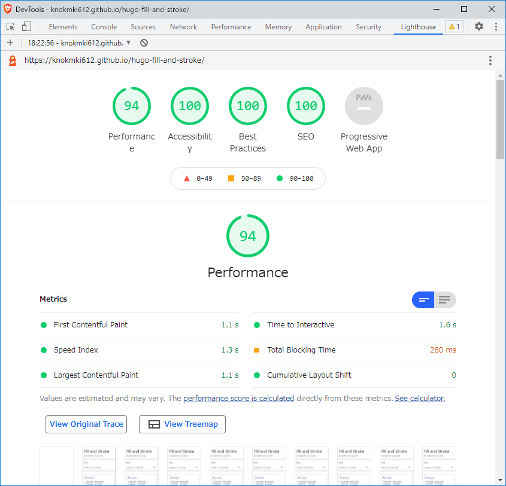
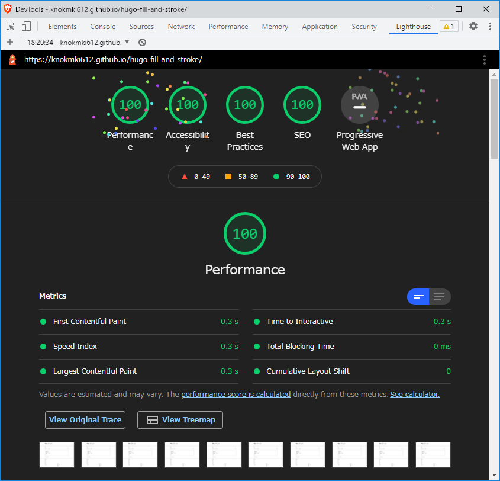

# Hugo Theme: Fill and Stroke

A simple design, for blog


## Example

https://knokmki612.github.io/hugo-fill-and-stroke/

## Lighthouse Scores

### Mobile



### Desktop



## Supported features

- Configurable Partial Templates
  - `favicons.html`
  - `side-menu/bannars.html` (Optional)
- Preset Content Types
  - blog
  - default
- Preset Taxonomies
  - tags
  - archives
- Preset Shortcodes
  - iframe
  - image
  - raw
  - tab
  - tweet
  - video
- i18n
- OGP
- Page Resources
  - Image
  - Video
- Menu Templates with nesting
- Cloudinary
- Dark Mode


## Installation

### As a Git submodule

```shell
$ hugo new site hugo-site
$ cd hugo-site
$ git init
$ git submodule add https://github.com/knokmki612/hugo-fill-and-stroke.git themes/fill-and-stroke
```

Then add the theme to your site configuration:

```toml
theme = ["fill-and-stroke"]
```

### As a Hugo module

Requires [Go](https://go.dev/) 1.18 or later and Git.

Import the theme in your site configuration:

```toml
[module]
  [[module.imports]]
    path = "github.com/knokmki612/hugo-fill-and-stroke"
```

Then initialize your site as a module and fetch the theme:

```shell
$ hugo mod init github.com/<owner>/<repo>
$ hugo mod get github.com/knokmki612/hugo-fill-and-stroke
```

With this method you do not set `theme`; the imported module mounts its own components.

## Configuration

```toml
baseUrl = "https://example.com/"
locale = "en-US"
title = "Example Site"
copyright = "2021 example"
theme = ["fill-and-stroke"]
defaultContentLanguage = "en"

[params]
description = "A simple site, for example"
# For `ogp:image`
images = ["favicons/310x310.png"]

[params.cloudinary]
enable = true
# See Also: https://cloudinary.com/documentation/how_to_integrate_cloudinary#create_and_tour_your_account
cloudName = "abcdefghi"
# See Also: https://cloudinary.com/documentation/dam_folders_collections_sharing
folder = "blog"

[params.cloudinary.transformations]
# See Also: https://cloudinary.com/documentation/user_defined_variables#named_transformation
article = "t_blog_thumb"
ogp = "t_blog_thumb"

[taxonomies]
tag = "tags"
archive = "archives"

[[menu.main]]
identifier = "example"
title = "Example"
url = "/example/"
weight = 1
```
